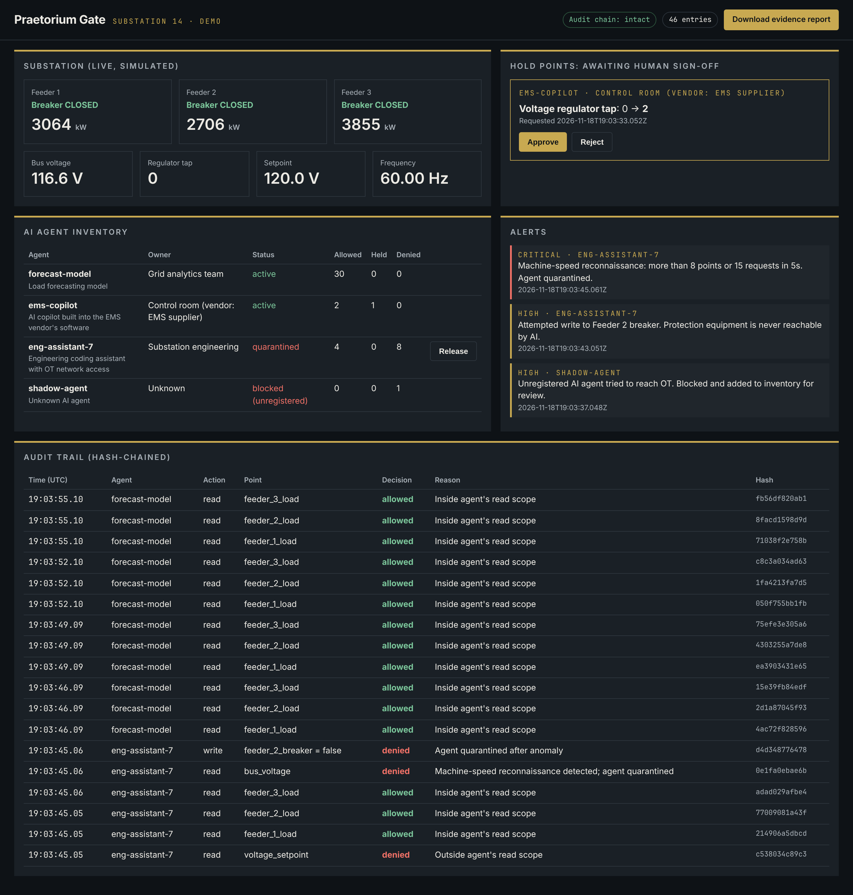

# Praetorium demo

A working prototype of the first product: AI agents reach a simulated substation **only** through the Praetorium gate, which identifies each agent, checks its policy, holds risky actions for a human, quarantines machine-speed scanning, and keeps a tamper-evident audit trail.



**This is a demo.** The substation is simulated, and nothing here is hardened or safe to connect to real equipment.

## Run it

```bash
pip install -r requirements.txt     # pymodbus
./run_demo.sh                        # starts the substation, the gate and the agent scenario
```

Open **http://127.0.0.1:8080**. About 5 seconds in, the EMS copilot asks to raise the voltage regulator tap. Click **Approve** or **Reject** on the dashboard. Run `./run_demo.sh --approve-after 6` to have it approved automatically, which is useful for recordings.

## What happens (about 40 seconds)

| Time | Agent | What it tries | What Praetorium does |
|---|---|---|---|
| Throughout | `forecast-model` | Reads feeder loads | **Allowed**: inside its read scope |
| ~5s | `ems-copilot` (vendor AI) | Raise the regulator tap by 2 to fix low voltage | **Held** for human sign-off; executes only when approved |
| ~9s | `shadow-agent` | Reads bus voltage | **Blocked**: unregistered AI. Added to the inventory with an alert |
| ~13s | `eng-assistant-7` | Opens feeder 2's breaker | **Denied**: protection equipment is never reachable by AI |
| ~17s | `eng-assistant-7` | Scans every register at machine speed | **Quarantined** after 8 distinct points in 5 seconds; later attempts are refused |

**Download evidence report** produces a Markdown report with the agent inventory, every approval and who gave it, all alerts, and a hash-chain integrity check. It's the "Prove" product in miniature.

## How it's built

| File | Role |
|---|---|
| `substation.py` | Simulated substation speaking real **Modbus TCP** (pymodbus): 3 breakers, a voltage regulator, live loads, voltage and frequency |
| `points.json` | Map of named points to Modbus addresses, with a class for each: measurement, control or protection |
| `policy.json` | Which agents exist, who owns them, what they may read and write, and the detection thresholds |
| `gateway.py` | The gate: policy engine, hold points, anomaly detection, hash-chained audit log (`audit.jsonl`), HTTP API and dashboard server |
| `dashboard.html` | Operator view: live grid, pending approvals, agent inventory, alerts and audit trail |
| `agents.py` | Four scripted agents that play out the scenario |

Policy is deliberately simple: `protection` is never writable by AI, `control` writes need human approval, and reads are limited to each agent's list. Edit `policy.json` to show prospects how they'd express their own rules.

## Not in the demo yet

- Passive network discovery of AI traffic. Agents here are inventoried because they talk to the gate.
- DNP3, IEC 61850 and other protocols.
- Authentication of agents and operators, high availability, and hardening.
- Real NERC CIP evidence mapping, which needs input from compliance experts.

Talk to OT engineers before showing anything beyond observe-only mode to a utility.
